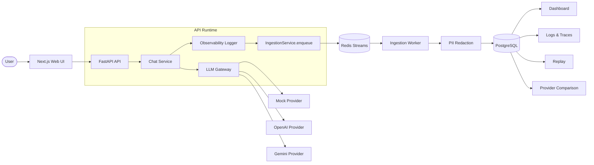
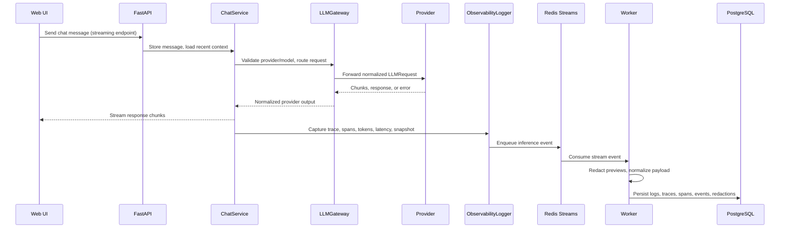

<div align="center">

# InferLens

**A full-stack LLM observability platform for tracing, replaying, and comparing inference calls across providers.**

[](https://nextjs.org/)
[](https://www.typescriptlang.org/)
[](https://fastapi.tiangolo.com/)
[](https://www.postgresql.org/)
[](https://redis.io/docs/data-types/streams/)
[](https://docs.docker.com/compose/)

</div>

InferLens ships a chatbot to generate traffic, but the real project is the infrastructure around every LLM call: provider routing, inference logging, Redis-based ingestion, PostgreSQL persistence, dashboards, trace replay, provider comparison, and PII-safe observability.

> Most teams can build a chatbot before they can explain what happened inside a single LLM request.

InferLens answers that question for every call — which provider and model handled it, how long it took, how many tokens and how much it cost, whether it streamed, failed, or was cancelled, what context was sent, whether sensitive data was redacted, and whether it can be replayed.

---

## Features

- Multi-turn chatbot with short context, streaming responses, and cancellation
- Provider-agnostic gateway with Mock, OpenAI, and Gemini adapters, plus retry and reciprocal fallback
- Provider/model validation to block invalid combinations
- Inference logs with latency, first-token timing, tokens, cost, status, and errors
- Redis Streams ingestion with an idempotent, dead-letter-backed worker
- PostgreSQL storage for messages, traces, logs, spans, stream events, and comparisons
- PII redaction on all observability previews
- Dashboard for requests, latency, errors, cancellations, tokens, cost, and provider usage
- Trace detail with spans, stream events, redactions, provider errors, and replay history
- Replay from safe request snapshots and provider comparison across configured models
- Optional OpenTelemetry export, `/metrics` Prometheus endpoint, and a deterministic benchmark

---

## Architecture



The request path stays focused: **UI → API → gateway → provider**. Observability data forks through the logger, queues in Redis, and is persisted asynchronously by the worker after redaction.

---

## Inference Flow



The user-facing stream returns immediately; persistence happens off the hot path, so observability never slows the response.

---

## Tech Stack

| Layer | Technologies |
| --- | --- |
| Frontend | Next.js App Router, TypeScript, Tailwind CSS, Recharts |
| Backend | FastAPI, Pydantic, SQLAlchemy, Alembic, Uvicorn |
| Database | PostgreSQL |
| Queue | Redis Streams |
| Providers | Mock, OpenAI, Gemini |
| Local Infra | Docker Compose |

---

## Core Pages

| Page | Purpose |
| --- | --- |
| `/chat` | Generate inference traffic |
| `/dashboard` | View latency, token, cost, error, and provider metrics |
| `/logs` | Inspect inference requests |
| `/traces/[traceId]` | Debug one request lifecycle |
| `/comparisons` | Compare provider/model performance |
| `/settings/providers` | View configured provider models |

---

## Quick Start

```bash
cp .env.example .env
# PowerShell: Copy-Item .env.example .env

docker compose up --build
```

Open:

- Web: http://localhost:3000/chat
- API health: http://localhost:8000/health

Run checks:

```bash
cd apps/api && python -m pytest
corepack pnpm@9.12.3 --dir apps/web build
docker compose config
```

Do not commit `.env`.

---

## Mock Mode

Mock mode runs the full observability pipeline without real provider keys. It still creates logs, traces, dashboard metrics, replays, comparisons, stream events, and redaction records.

```env
LLM_MOCK_MODE=true
DEFAULT_PROVIDER=mock
DEFAULT_MODEL=mock-fast
```

| Model | Purpose |
| --- | --- |
| `mock-fast` | Fast successful response |
| `mock-slow` | Slow streaming response for cancellation testing |
| `mock-error` | Simulated provider error |

To use real providers, set `LLM_MOCK_MODE=false` and configure backend-only keys (`OPENAI_API_KEY`, `GEMINI_API_KEY`).

---

## Deployment

A typical hosted deployment runs separate services for **web, API, worker, Postgres, and Redis**.

- **Frontend** — deploy `apps/web` as a Next.js app; set `NEXT_PUBLIC_API_BASE_URL`.
- **API** — deploy `apps/api` as a Docker service with `SERVICE_ROLE=api`, `DATABASE_URL` (`postgresql+psycopg://`), `REDIS_URL`, and CORS origins. URL-encode special characters in the DB password.
- **Worker** — deploy `apps/api` again with `SERVICE_ROLE=worker-web`, which starts a small health server plus the Redis ingestion loop. Use a Redis TCP URL (`redis://` or `rediss://`), not a REST URL.

Worker health should return:

```json
{"status":"ok","worker":"running"}
```

### Checklist

- API health returns `{"status":"ok"}`
- Provider configs load from `/api/providers`
- Worker health returns `{"status":"ok","worker":"running"}`
- Frontend loads `/chat`
- A `mock / mock-fast` message creates a log row
- Dashboard request count updates
- A log row opens its trace page

---

## Security & Reliability

- PII redaction covers emails, phone numbers, API-key-like strings, JWT-like tokens, and credit-card-like patterns in observability previews
- API keys, headers, cookies, bearer tokens, and secrets are never persisted in snapshots or raw metadata
- Provider error messages are sanitized before display; canonical chat content stays separate from redacted previews
- Failures are normalized in traces (invalid provider/model, missing key, rate limit, model not found, server error, cancellation, worker failure)
- Ingestion is idempotent by `event_id`; repeated failures move to dead-letter storage

### Gateway resilience & telemetry

- Every adapter returns a normalized result and safe error category. With both real keys set, OpenAI and Gemini retry once then fall back to each other; with one key, that provider retries once. `PROVIDER_FALLBACKS` overrides the default, but Mock is never a runtime fallback for a real-provider failure.
- With no real keys, InferLens uses deterministic `mock/mock-fast`; `LLM_MOCK_MODE=true` forces that mode even when keys exist. Mock responses always record as `provider=mock`.
- `CONTENT_CAPTURE_ENABLED=false` by default — logs then hold metrics and safe metadata only. When enabled, previews, stream events, and snapshots are PII-redacted and bounded before persistence.
- OpenTelemetry is optional (`OTEL_ENABLED=false`). Set `OTEL_EXPORTER_OTLP_ENDPOINT` for OTLP HTTP/protobuf export; export failure is non-fatal and no raw prompt/response attributes leave the process. Redis envelopes carry W3C trace context when telemetry is active.

### Health, metrics & benchmark

- `GET /health/live` checks the process; `GET /health/ready` reports database, Redis, and provider-registry readiness without secrets.
- `GET /metrics` exposes low-cardinality Prometheus metrics for latency/TTFT, tokens, cost, retries, fallbacks, Redis publishing, worker errors, dead letters, replays, comparisons, and redactions.
- Run the deterministic benchmark with `cd apps/api && python -m app.benchmarks.mock_gateway_benchmark`.

> Latest local Mock benchmark (2026-08-02 UTC, Windows 10, Python 3.11.6, 50 requests, concurrency 10): **21,523.89 req/sec**, **0.020 ms** P50 and **0.049 ms** P95 request latency. These use a no-delay in-process Mock provider and are **not** real-provider or production throughput.

---

## License

MIT
